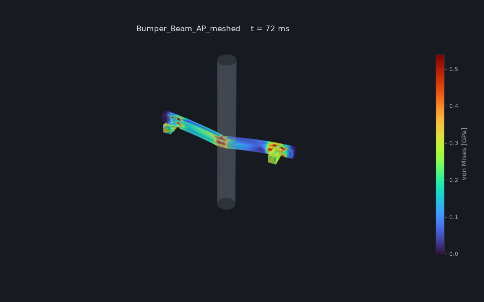
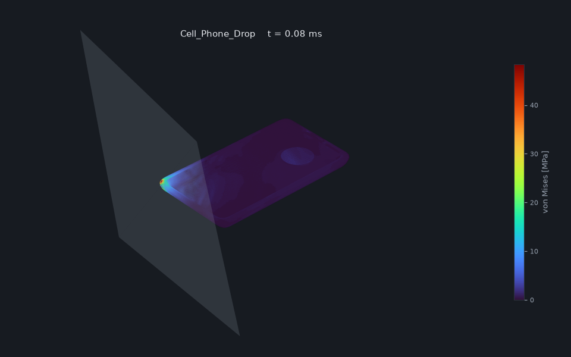
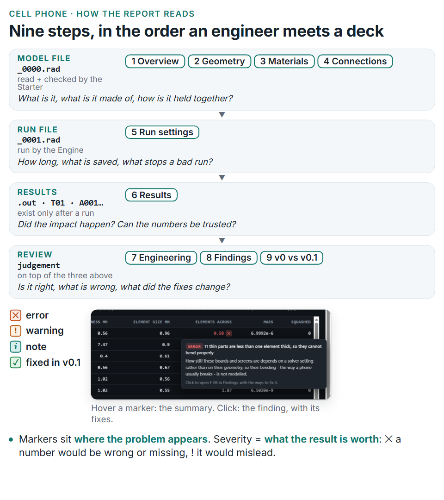
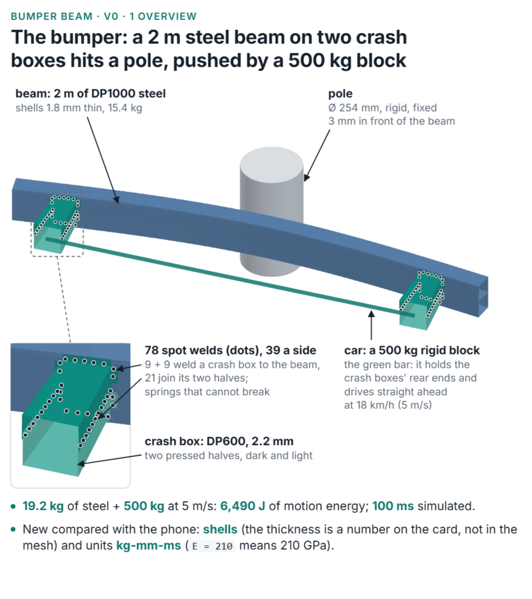
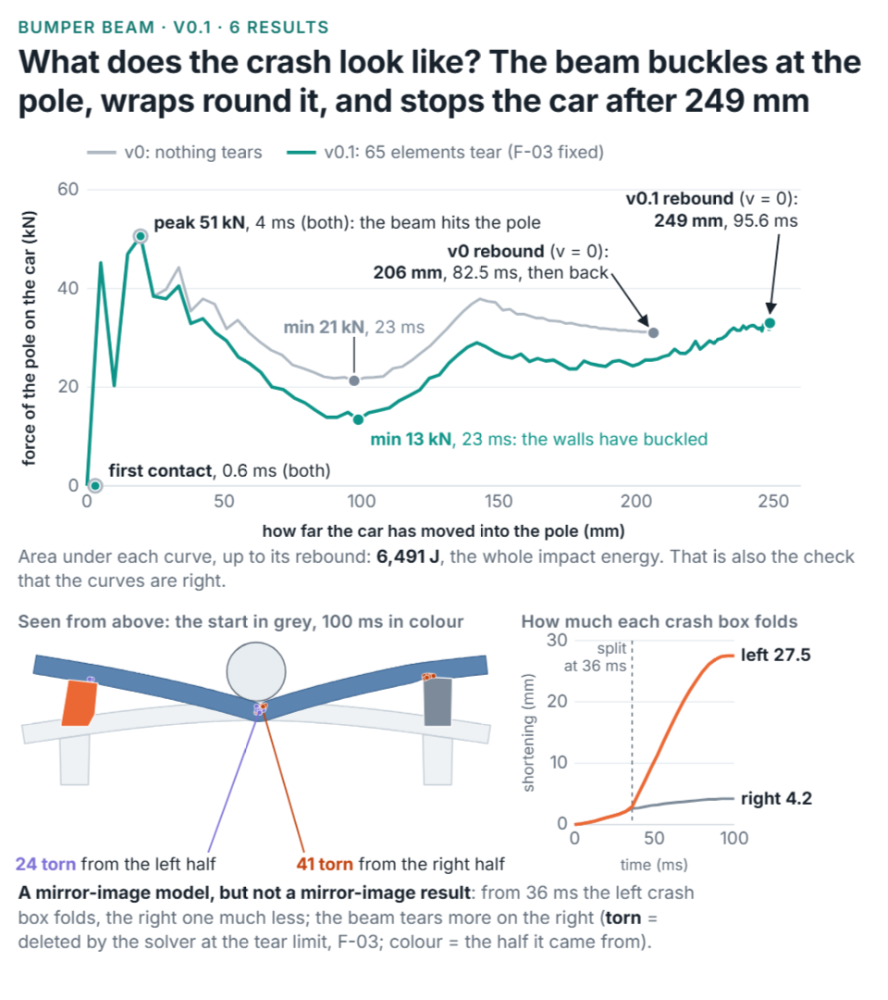
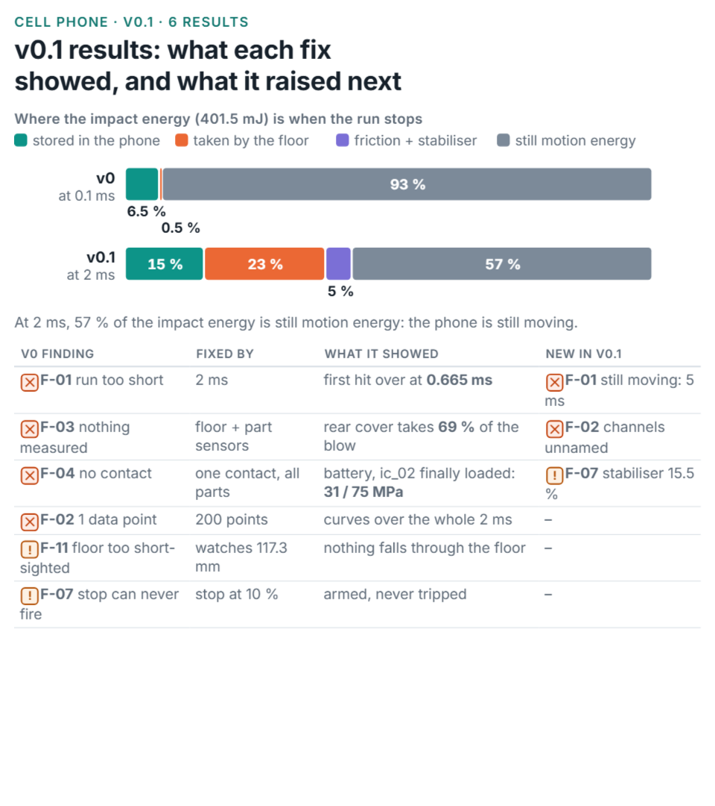
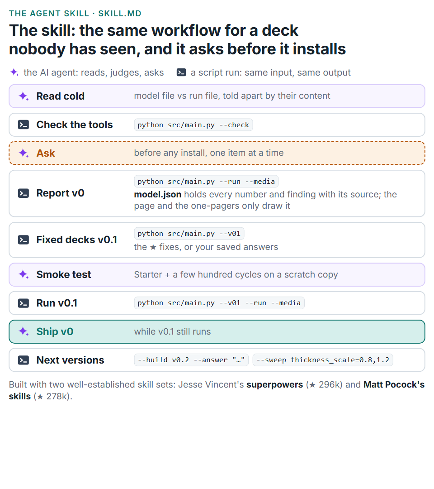
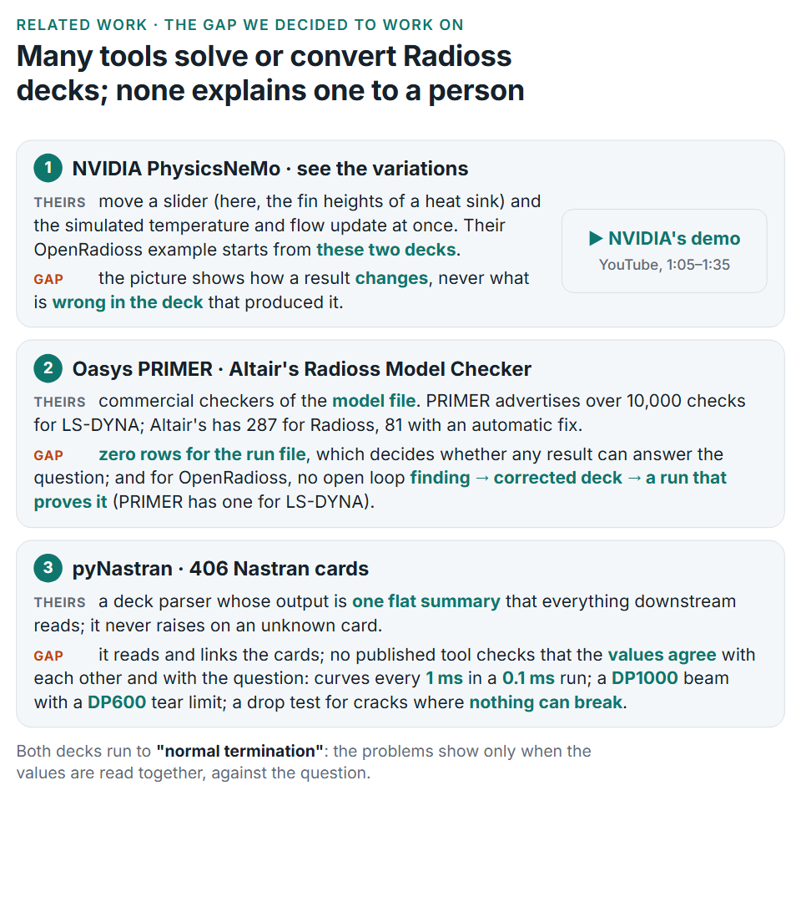
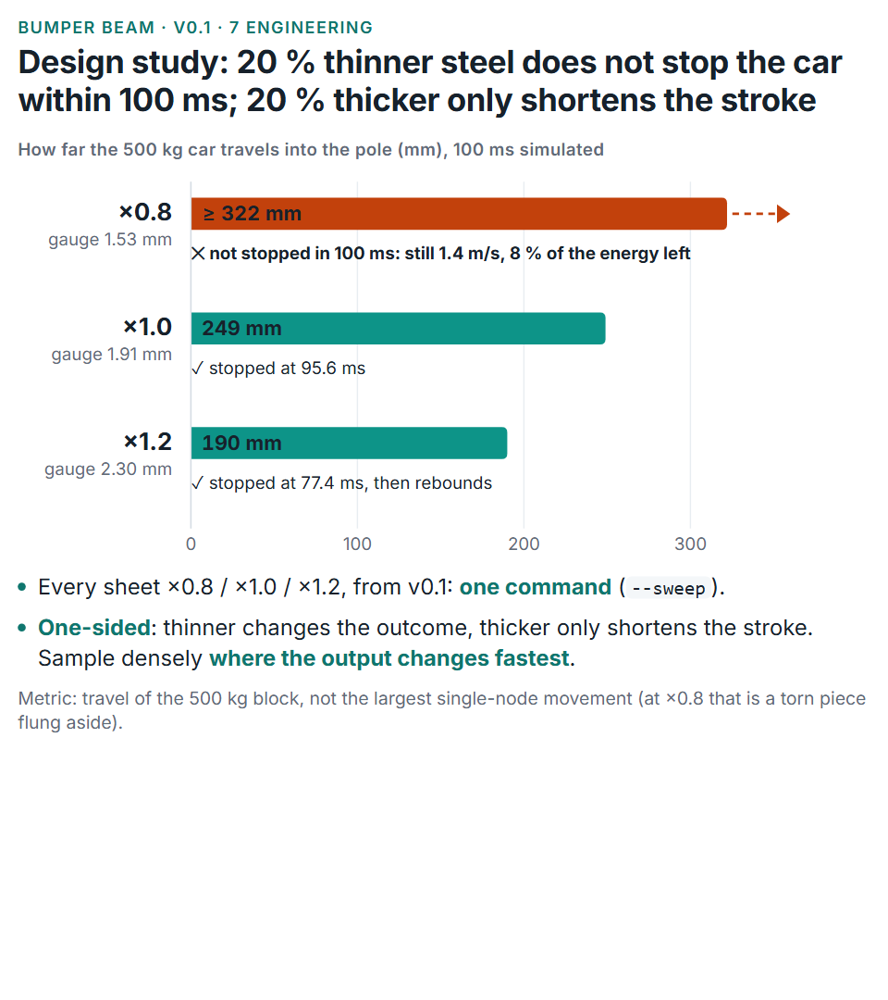

# OpenRadioss Viewer

**Read an explicit crash-simulation deck and explain it to an engineer who has never opened it.**

The tool parses an OpenRadioss / Altair Radioss impact model (`*_0000.rad` + `*_0001.rad`) and
builds one interactive HTML report. The report covers what hits what, how fast and with what mass,
how the model is assembled, and which settings will shape the answer before the physics does.
It lists what is wrong with the model, builds a corrected version, runs both and compares them.

### [▶ Watch the talk: 26 slides](https://karim-53.github.io/OpenRadioss-Viewer/talk/) · [Open the live report](https://karim-53.github.io/OpenRadioss-Viewer/report.html) · [Home page](https://karim-53.github.io/OpenRadioss-Viewer/)

The report covers two public OpenRadioss example models: a bumper beam hitting a rigid pole, and
a phone dropped onto a floor. It runs from `file://` with no server and no network, so GitHub
Pages serves it unchanged.

| Bumper beam into a pole, peak stress | Phone drop, first contact |
|---|---|
|  |  |

---

## What the report does



Nine steps, in the order an engineer meets a deck, grouped by the file they read:

* **Model file (`_0000.rad`)**: what is it, what is it made of, how is it held together?
  * **Overview:** the scenario in one sentence, the units, and a glossary.
  * **Geometry:** the 3D assembly. You can switch parts off and colour them by thickness, mass,
    mesh size or, after a run, peak stress, plastic strain and displacement.
  * **Materials:** laws, failure criteria and their presets.
  * **Connections:** ties, contacts and rigid bodies, computed from the mesh rather than read off
    the interface names.
* **Run file (`_0001.rad`)**: how long, what is saved, what stops a bad run?
  * **Run settings:** how long the run is, what it saves, and what would stop a run that goes
    wrong.
* **Results**: did the impact happen, and can the numbers be trusted?
  * The energy balance, how trustworthy the run is, the video and the key moments.
* **Review**: is it right, what is wrong, what did the fixes change?
  * **Engineering:** the dimensions that decide the answer, manufacturability and tolerances.
  * **Findings:** what is wrong, why, what it means, and choices for fixing it.
  * **v0 vs v0.1:** the original model against the corrected one.

Each problem is marked where it appears (✕ error, ! warning, i note). The severity says what
the result is worth: ✕ a number would be wrong or missing, ! it would mislead. Hovering over a
marker shows a summary; clicking it opens the finding. You can answer each finding in the page
and save the answers as `interaction.txt`. The next build then applies your answers instead of
the recommended defaults.

<br clear="right">

## What it found in the two models

Every line of both decks is legal on its own, and both run to "normal termination". The
problems show only when the values are read together, against the question the model is meant
to answer.

### Bumper beam

| The model | The crash in curves |
|---|---|
|  |  |

A 2 m DP1000 steel beam (1.8 mm shells) on two DP600 crash boxes, held by 78 spot welds, pushed
by a 500 kg rigid block at 5 m/s (18 km/h) into a 254 mm rigid pole: 519 kg and 6,490 J of
motion energy, 100 ms simulated. Four fixes:
* The force channels were being read as impulses: every "force" column of the time history is a
  running total. Adding `/TH/TITLE` fixed that.
* The run had no open-format 3D output. Adding `/ANIM` produced it; the video comes from this.
* The run had no safety stop. `/STOP` was added.
* The DP1000 sheets used the DP600 failure setting: a tear limit of 0.50 where an
  ultra-high-strength steel tears at 0.12, about four times less stretch. It was switched to the
  UHSS rule, `/FAIL/BIQUAD` `M_Flag` 2 → 3.

What the runs show:
* **The crash in four moments.** First contact at 0.6 ms; the peak, 51 kN at 4 ms, is the beam
  hitting the pole; the crash-box walls buckle and the force drops to 21 kN (13 kN once the
  steel can tear); the beam wraps round the pole and the car stops after 206 mm (249 mm in the
  corrected run, where 65 elements tear).
* **The curves check themselves.** The area under force against travel, 6,491 J, gives back the
  whole impact energy.
* **A mirror-image model, not a mirror-image result.** From 36 ms the left crash box folds by
  27.5 mm and the right one by 4.2 mm; 24 elements tear from the left half of the beam and 41
  from the right.
* In both runs the impact takes out all the motion energy, about 95 % of it into deformation.
  The corrected run shows a peak stress of 0.7 GPa and a largest permanent stretch of 35 %.
* Reported but left as is: 942 initial overlaps at t = 0, all on the welded flanges.

### Phone drop



A 27 g phone lands corner first at 5.42 m/s, the speed of a 1.5 m drop, on a rigid floor. What
is wrong in the original:
* **The run stops at 0.1 ms**, in the middle of the first hit: 93 % of the energy is still
  motion when it ends.
* **The battery and a chip (`ic_02`), 24 % of the mass, are tied to nothing.**
* **The floor watches 32.6 of the phone's 97.7 mm**: two of its four corners.
* **16 of the 17 materials are perfectly elastic**, so nothing can break. A drop test asks
  "does the screen crack?"; this model can only answer with a stress margin.
* The thinnest boards are one brick element thick, so they cannot bend properly.
* 27 g is about 17 % of what a real phone this size weighs.

Seven fixes in the corrected version (v0.1):
* The run lasted 0.1 ms, which ends before the impact does. It now runs for 2 ms.
* The curves were sampled once. They are now sampled 200 times.
* The floor has a force sensor, and energy is recorded per part.
* One general contact (`/INTER/TYPE24`) now covers all parts.
* The safety stop can actually trigger.
* `/PARITH/ON` makes the arithmetic repeatable across thread counts.
* The rigid wall watches the whole phone.

What the 2 ms run shows:
* **The first hit is over at 0.67 ms.** It takes out 44 % of the motion energy. The phone then
  pivots on its corner towards a second hit; at 2 ms, 57 % of the energy is still motion.
* **The rear cover absorbs 69 % of the blow**, the screen 10 % and the battery 6 %.
* **The loose parts now carry load:** the battery 31 MPa and `ic_02` 75 MPa, up from zero; the
  screen goes from 60 to 84 MPa.
* **The solver's energy error of 6.8 % is fully explained.** It is friction in the new contact
  (3.4 %) plus hourglass energy (2.2 %). Counting both, the balance closes to 0.3 %.
* **Hourglass energy reaches 15 % of the internal energy**, above the usual 10 % limit. The thin
  plates are meshed with less than one solid element through their thickness. The fix is a
  re-mesh with shells, not a deck edit.

<br clear="right">

### Design study: bumper sheet thickness

Every sheet was scaled by 0.8, 1.0 and 1.2, starting from the corrected model, with one command
(`--sweep`). Travel is how far the 500 kg block goes into the pole:

| Thickness | Mean gauge | Travel in 100 ms | Stopped? | Highest stress | Largest permanent stretch |
|---|---|---|---|---|---|
| × 0.8 | 1.53 mm | ≥ 322 mm | **no**: still 1.4 m/s, 8 % of the energy left | 782 MPa | 31 % |
| × 1.0 | 1.91 mm | 249 mm | at 95.6 ms | 705 MPa | 35 % |
| × 1.2 | 2.30 mm | 190 mm | at 77.4 ms, then rebounds | 695 MPa | 27 % |

The response is strongly one-sided. With 20 % less steel the car is not stopped within the
100 ms. With 20 % more steel it only stops sooner. That is the kind of cliff a tolerance study
exists to find, and it sits on the thin side of the nominal design: sample densely where the
outcome changes fastest.

## Where it sits: related work and the gap

Solvers, converters and result readers for Radioss decks are plentiful. A tool that explains a
deck to a person was not.

* **NVIDIA PhysicsNeMo** lets you move a design slider and see the simulated result change; its
  OpenRadioss example starts from these same two decks. It shows how a result changes, never
  what is wrong in the deck that produced it.
* **Commercial model checkers** (Oasys PRIMER advertises over 10,000 checks for LS-DYNA; Altair's
  Radioss Model Checker has 287, 81 with an automatic fix) check the model file. They have no
  rows for the run file (`/RUN`, `/STOP`, `/ANIM`, `/H3D`, `/TFILE`), which decides whether any
  result can answer the question. For OpenRadioss, nothing open closes the loop from finding to
  corrected deck to a run that proves it.
* **Deck parsers** such as pyNastran read and link the cards into one summary. No published tool
  checks that the values agree with each other and with the question: curves every 1 ms in a
  0.1 ms run, a DP1000 beam with a DP600 tear limit, a drop test for cracks where nothing can
  break.

This project covers that gap: findings on both files, line by line and as a whole; fixes with
their cost and a v0.1 that runs and is compared with the original; and a page where the engineer
confirms a finding, picks another fix or writes a note, then hands `interaction.txt` to an AI
agent. For a team that trains surrogate models on simulation results, it is the intake check
before training: a run that stops at 0.1 ms, records one data point, or saves its fields only
as `.h3d` gives rows nobody can train on.

## How the analysis is built

* **Fields are read by name, not by position.** Starter decks are fixed width on a
  ten-character ruler, and every card carries a `#` comment that names its fields. The parser
  reads the column layout from that line instead of hard-coding it per keyword, so a new keyword
  costs nothing. Splitting on whitespace would shift every value after a blank field. In these
  decks that silently turns a rate-independent steel into a rate-hardening one.
* **The Engine deck is parsed separately.** It is whitespace-delimited, and several of its cards
  (including `/RUN`) have no header at all.
* **The numbers are checked against the solver.** Node and element counts and the mass of every
  part are compared with the Starter's own listing. Both models reconcile to 0.000 %.
* **Presets and flags are checked against the solver's own definitions** (`hm_cfg_files`), not
  against memory. That check corrected one table: `/FAIL/BIQUAD` preset 5 is aluminium
  AA6082-T6, not a plastic.
* **The originals are never edited.** Every fix is a named edit of one field, applied to a copy
  and recorded as a unified diff (`deck.diff`) and in `edits.json` with its reason. A version can
  be restored byte-for-byte from its diff. Tests check both.
* **Each patched deck is smoke-tested before the long run:** the Starter plus a few hundred
  cycles. That caught a real error: a contact surface over solid parts must be `/SURF/PART/EXT`.
* **Design studies use the same mechanism, aimed at a design variable.** Each run writes one row
  of inputs and outcomes (`report/global_features.json`), which is the shape a surrogate model
  trains on.

## Skills this project shows

* **Explicit FE crash simulation:** elasto-plastic steels with failure (`/FAIL/BIQUAD`), ties
  versus contacts (`/INTER/TYPE2`, `TYPE7`, `TYPE24`), rigid walls and rigid bodies, initial
  velocity and gravity. Also time step and added mass, the energy balance, and hourglass control.
* **Engineering judgement over keyword dumps:** finding what decides the answer, spotting what
  is physically wrong, and quantifying a fix by running it.
* **Python engineering:** a fixed-width parser, mesh boundary extraction with numpy, interactive
  3D with plotly, video rendering, and a pytest suite that checks results against the solver's
  own output.
* **Automation and AI workflows:** one command from deck to report, a reproducible
  fix → run → compare loop, and an agent skill that runs the same workflow on a deck nobody has
  seen.
* **Explaining it:** a report written for a newcomer, and a 26-slide talk that walks an
  audience through it.

## Quick start

```bash
python -m venv .venv
source .venv/bin/activate            # Windows: .venv\Scripts\activate
python -m pip install -r requirements.txt

python src/fetch_models.py           # download the two example decks and verify their SHA-256 (see TODO)
python src/main.py --check           # what is installed and what is missing
python src/main.py                   # read the decks, write index.html (~1 min)
python -m pytest -q                  # the tests
python src/build_site.py             # copy the built report into docs/ for GitHub Pages
```

This needs Python 3.12 or newer. It was developed on Windows 11 with Python 3.12.10.

Any folder next to `src/` that holds a `*_0000.rad` is treated as a model. To analyse another
deck pair, put it in its own folder and it gets the same report.

### With the solver (optional)

The report is built from the decks alone. Running the solver adds the Results step, the video,
the corrected version and the comparison. Point `OPENRADIOSS_PATH` at an unpacked
[OpenRadioss release](https://github.com/OpenRadioss/OpenRadioss/releases), then:

```bash
python src/main.py --run --media        # run the original decks, render stills and video
python src/main.py --v01 --run --media  # build the corrected decks (v0.1), run and compare them
python src/main.py --model Bumper_Beam --sweep thickness_scale=0.8,1.2 --run   # a design study
```

Runs behind the published report, on a 6-core laptop CPU:

| Run | Starter | Engine | Result |
|---|---|---|---|
| Bumper beam, original | 26.5 s | 501 s, 100 000 cycles | normal termination |
| Bumper beam, corrected | 1.7 s | 1 345 s, 100 000 cycles | normal termination |
| Phone drop, original | 30.2 s | 631 s, 2 676 cycles | normal termination |
| Phone drop, corrected | 14.6 s | 5 660 s, 53 513 cycles | normal termination, 2 ms instead of 0.1 ms |
| Bumper beam, thickness × 0.8 and × 1.2 | — | 1 116 s and 1 033 s | normal termination |

### The agent skill



[`skill/openradioss-explore/SKILL.md`](skill/openradioss-explore/SKILL.md) is written for an AI
coding agent, following the `SKILL.md` convention, and also reads as a plain playbook for a
person. Each step is either the agent's judgement (read, judge, ask) or a script run (same input,
same output). Given a new deck pair, it goes through these steps:
* Read the decks cold: model file and run file, told apart by their content.
* Check the environment, and ask before installing anything, one item at a time.
* Build the report and run the solver. `model.json` holds every number and finding with its
  source; the page and the one-pagers only draw it.
* Propose fixes, then build v0.1 and smoke-test it on a scratch copy.
* Ship v0 while v0.1 runs.
* Build the next versions from the saved answers, or sweep a design variable.

<br clear="right">

## The talk

[`talk/`](talk/) holds a 26-slide presentation of this project (React + reveal.js), made to sit
on one half of the screen with the live report on the other half: the slides give the overview,
the report shows the page. It walks through the phone page by page, then only what is new on the
bumper, the agent skill, related work, and a backup of 17 slides for questions.

| Related work and the gap | Design study |
|---|---|
|  |  |

To present it: `cd talk && npm install && npm run build`, then open `talk/dist/index.html`.
Details in [`talk/README.md`](talk/README.md).

## Repository layout

| Path | What it is |
|---|---|
| `docs/` | The published report, served by GitHub Pages |
| `src/main.py` | The one command; the other files in `src/` are modules it calls |
| `src/fetch_models.py` | Downloads the example decks and verifies them |
| `src/build_site.py` | Copies the built report into `docs/` |
| `src/web/` | The report's page, script and styles |
| `skill/openradioss-explore/` | The agent skill |
| `talk/` | The presentation (React + reveal.js) and its slide images |
| `tests/` | Parser, Engine-deck, pipeline and output checks |

## TODO

- [ ] **Put the talk online**, as a GitHub Pages page next to the report (`docs/talk/`) or as a
      recorded video. The steps for both are in [`talk/README.md`](talk/README.md).
- [ ] **Switch GitHub Pages on** (Settings → Pages → `main`, `/docs`) once the repository is
      public. The "Open the live report" link above needs it.
- [ ] **Give `src/fetch_models.py` a working source.** The OpenRadioss wiki space it downloads
      from is now locked (the OpenRadioss site redirects to Siemens), so the download fails. The
      SHA-256 checks stay valid. Options: a new official URL, or ship the four decks in the
      repository, which CC BY-NC 4.0 allows with attribution for non-commercial use.

## Licence and credits

* **Code:** MIT, see [LICENSE](LICENSE).
* **Models:** *Bumper Beam* and *Cell Phone Drop Test* are © 2022 Altair Engineering Inc.,
  published as OpenRadioss example models under
  [CC BY-NC 4.0](https://creativecommons.org/licenses/by-nc/4.0/). They are not stored in this
  repository: `src/fetch_models.py` was written to download them from the OpenRadioss wiki (see
  TODO). The report in `docs/` and the talk in `talk/` contain geometry and results derived
  from them, and are shared under the same licence.
* **Related work** named in the report and the talk (NVIDIA PhysicsNeMo, Oasys PRIMER, Altair's
  Model Checker, pyNastran) belongs to its owners; the talk links to NVIDIA's demo video rather
  than copying it.
* This project is independent. It is not affiliated with or endorsed by Altair, Siemens or the
  OpenRadioss project.

## About me

I'm Mohamed Karim Belaid, a data scientist. For six years I worked inside Porsche's
passive-safety department on the frontal crash-test programme, as a consultant with IDIADA.
There I built models that catch failed sensor channels, reconstruct lost signals, and predict
untested occupant configurations from physical tests and simulation output. I also built an LLM
agent that answers engineers' crash-data questions. I'm finishing my PhD at LMU Munich on
machine learning.

This project is the simulation-side counterpart: reading the model itself and explaining it the
way a crash engineer would want it explained.

[LinkedIn](https://www.linkedin.com/in/mohamedkarim-belaid) ·
[Google Scholar](https://scholar.google.com/citations?hl=en&user=F8QtCPIAAAAJ) ·
[GitHub](https://github.com/Karim-53)
