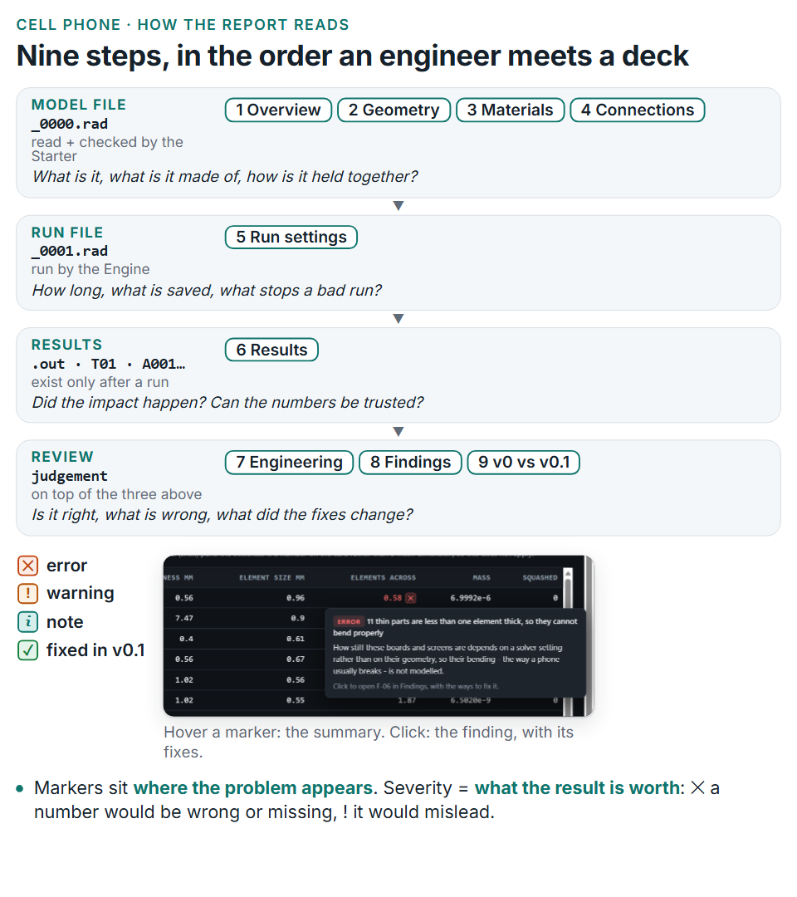
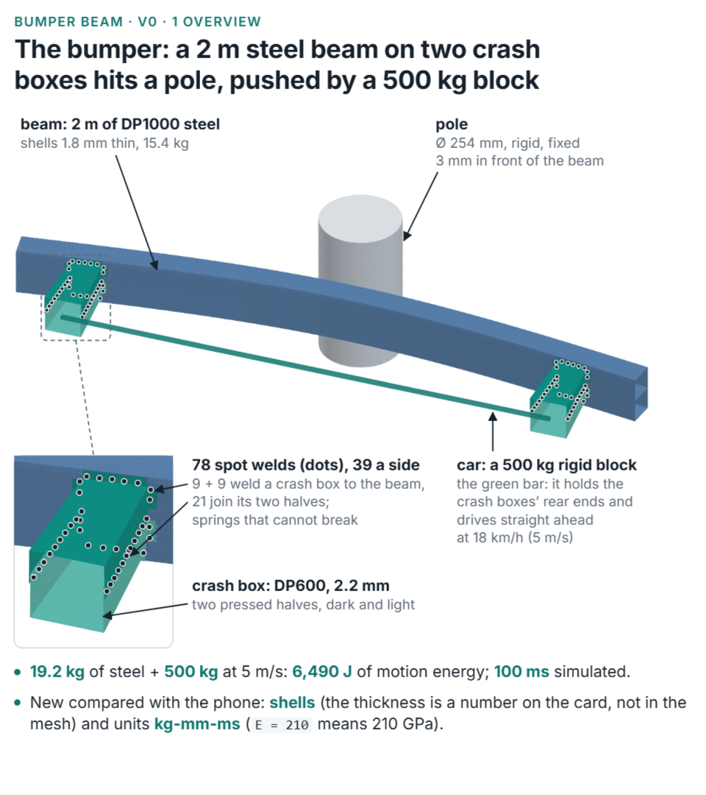
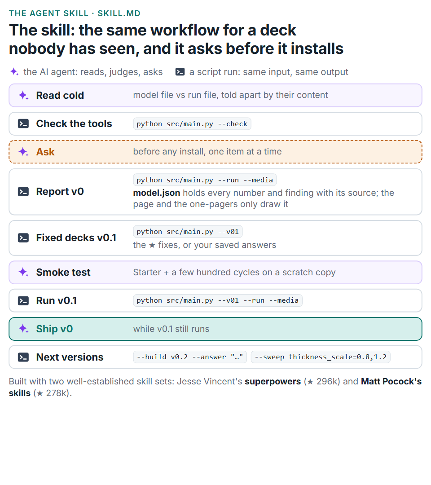

# The talk: OpenRadioss Viewer in 24 slides

A 60-minute presentation of this project: what the report finds in the two example decks, how
the numbers are checked against the solver, what the fixes change, and the agent skill that
repeats the workflow on a new deck. Built with React and reveal.js.

| | | |
|---|---|---|
|  |  |  |

## TODO: make the talk reachable without cloning the repo

Live: **https://karim-53.github.io/OpenRadioss-Viewer/talk/** (rebuild with step 1 after any change).

- [x] **Publish it on GitHub Pages**, next to the report.
  1. Build into the published folder: `npx vite build --outDir ../docs/talk --emptyOutDir`.
  2. Link it from the main README: `https://karim-53.github.io/OpenRadioss-Viewer/talk/`.
  3. Switch Pages on (Settings → Pages → branch `main`, folder `/docs`). Pages needs the
     repository to be public, or a paid plan.
  4. Optional: make each slide's kicker a link to the matching report page, so the deck and the
     report work side by side from one URL.
- [ ] **Make the final video** from the recording that already exists.
  - **The raw recording:** a screen capture of the whole talk presented live on 2026-10-08, in
    two files (about 9 + 51 minutes, 105 MB + 424 MB): the deck on one half of the screen, the
    live report on the other, with the voice-over. It is not in the repository (too large, and
    it shows an earlier, privately branded version of the deck). On Karim's machine, the
    shortcut **`talk/recording (raw talk video).lnk`** opens its folder (git-ignored, local only).
  - **Edit before publishing:**
    - Replace the opening title slide with this repository's title slide (`#/0`, render it with
      the headless-Edge command under "Checking the layout").
    - Cut the PhD overview (and any paper slide shown) that follows About me; this deck no
      longer has them.
    - Crop or blur the browser tab title, and cut anything that names the event or its people.
    - Check the audio for voices other than the presenter, and cut them.
    - Optionally trim to a ~15-minute cut of the main path (no backup, no Q&A).
  - Upload it (YouTube, unlisted is fine) and embed the link in the main README and here.
  - Fallback if the recording is unusable: one PNG per slide, the speaker notes read by a TTS
    voice, and `ffmpeg` to join them.

## Present: half the screen each

The deck is **8:9** (640 × 720 canvas): it fills **one half** of a 16:9 screen, and the live
report (`docs/index.html`, or the published page) fills the other half. The slides give the
overview; the report shows the actual page and sentence. Every slide's kicker names the report
page to show next to it, e.g. "Cell Phone · v0 · 2 Geometry".

1. Build once (see **Edit**), then open **`dist/index.html`** by double-clicking it. It works
   offline from `file://`: all JavaScript, CSS and the Inter font are inlined; the screenshots
   and videos sit next to it in `dist/shots/` and `dist/media/`. Copy the whole `dist/` folder
   if you move it.
2. Snap the browser window to one half (Win + ←), the report to the other (Win + →).
3. No full screen needed: the deck scales to whatever window it is in.

Navigation is **2D**: columns go right (→), stacks go down (↓). Space / PageDown (a clicker's
"next") walk every slide in reading order, down each stack.

| Key | What it does |
|---|---|
| ↓ / ↑ | next / previous slide in the current stack |
| → / ← | next / previous column (skips the rest of a stack) |
| Space PageDown (clicker "next") | next slide in reading order |
| **S** | speaker view: notes with the time cue, current + next slide, timer |
| **O** or Esc | overview of all slides: click one to jump (e.g. into the backup) |
| B or . | black screen (pause) |

If the speaker view does not open, the browser blocked the pop-up: allow pop-ups for the
file, or serve the folder (`python -m http.server --directory dist 8767`, then open
<http://localhost:8767>).

Deep links work: `index.html#/2/2` is column 2, slide 2 (the phone's Geometry). The slide
number (top right) counts the main path, 24 slides; the backup slides after the last one are
uncounted.

**More details.** Some slides end with a dashed rule labelled "more details:". What sits below it
stays on the slide for questions but is not presented (cut for the 60 minutes). The Engineering slide
(phone, 7) has a switch, Visual · What I need to know · Table: click it with the mouse; it never takes
the keyboard focus, so Space still advances.

## Structure (columns; each stack is walked top to bottom)

| Col | File | Slides | Clock |
|---|---|---|---|
| 0 | `src/slides/00_Title.jsx` | Title | 0:00 |
| 1 | `src/slides/01_Intro.jsx` | About me: career in one slide | 0:30 → 2:00 |
| 2 | `src/slides/03_Models.jsx` | The two models; the reader is a newcomer | 3:15 |
| 3 | `src/slides/04_Phone.jsx` | 11: how the report reads, then the Cell Phone page by page; the Overview carries "what I built" (report, suggest fixes, recommend one, compare) on F-01; Engineering in three views; v0.1 results and where the blow goes | 4:15 → 24:30 |
| 4 | `src/slides/05_Bumper.jsx` | 7: the Bumper Beam, only what is new: the annotated picture, materials (F-03), connections, run settings, the crash in curves, all 7 findings, the thickness study | 24:30 → 35:15 |
| 5 | `src/slides/06_Skill.jsx` | 1: the skill's workflow (each step marked AI agent or script, its command in the box), built on superpowers and Matt Pocock's skills | 35:15 → 36:45 |
| 6 | `src/slides/07_FutureWork.jsx` | 1: future work on the report, grouped by page | 36:45 → 38:15 |
| 7 | `08_RelatedWork.jsx` ↓ `10_Contribution.jsx` | one column: related work, each with the gap it leaves (NVIDIA's demo is a link to their video), then the contribution (one card per gap) | 38:15 → 42:15 |
| 8 | `src/slides/11_QA.jsx` + `12_Backup.jsx` | thank you / Q&A; below it 17 backup slides: the phone's v0.2 decisions first, then the phone's v0.1 fixes, can we trust v0.1, the phone in one table, the bumper's v0.2, the skills it builds on, how I used AI, glossary, … | ~42:15 planned |

The clock is the planned pace: about 42 minutes of talking. The cues in the speaker notes from
slide 3 on still include the PhD overview that was removed, so the talk now runs about 1.5 minutes
ahead of them. Showing the live report next to each
slide (hover a marker, open a card, flip v0/v0.1) and answering questions during the talk usually adds
8 to 12 minutes, so the 60-minute slot ends around 50 to 55 minutes. The slides cut for time live with
their column's file (`PhoneV02`, `PhoneFixes`, `PhoneTrust`, `PhoneTable` in `04_Phone.jsx`, `BumperV02`
in `05_Bumper.jsx`, `SkillBuiltOn` in `06_Skill.jsx`) and are rendered at the top of the backup.

The slides follow one rule: every error or warning is led by its id and explained **once**; a
later slide only points back to it ("already met on …"). The screenshots that remain are the ones
the live report cannot show side by side.

## Edit

```bash
cd talk
npm install          # once
npm run dev          # http://localhost:5173 with hot reload
npm run build        # rewrites dist/index.html (single file) and copies public/ next to it
```

- `src/App.jsx`: reveal.js set-up (640 × 720, 2D navigation, on-screen arrows bottom-right,
  fade, slide numbers, notes plugin). Any config key can be overridden from the URL, e.g.
  `index.html?transition=none#/4/2`.
- `src/components/`: `Slide` (`src` = the files a slide's numbers come from; they go into the
  speaker notes), `Stack`, `Head`, `Say`, `F` (a finding led by its id), `Seen` and `QA` (unused
  at the moment), `Shot`, `Legend` / `Mark`, `Stat`, `Callout`, `Video`, `Card`, `More` (the
  "more details:" rule), `Views` (the three-view switch).
- `src/charts/`: inline-SVG figures and charts: the phone and bumper connection graphs, the
  bending / hourglass figure (F-06), the wedge figure (F-09), the energy split, the run-file
  excerpts, stress v0 vs v0.1, energy per part, the energy books, the bumper's impulse vs
  force and energy books, the thickness sweep, and the bumper's annotated 3D picture
  (`BumperOverview`), force vs crush (`BumperCrush`) and left vs right (`BumperSides`).
  `charts/EngVisuals.jsx` holds the three pictures of the Engineering switch. Their numbers live
  in `src/data/numbers.js`, each with the file it was read from; numbers computed after the
  report was built are marked `[MY]`.
- `src/intro/`: the About me slide, re-flowed for 8:9.
- `src/theme.css`: this deck's styles on top of `src/intro/intro.css`. Note: intro.css gives
  `.bar` a fixed width that CSS also applies to SVG `<rect>`s, so rect bars use the class `bx`.

### The Bumper's picture and curves

`BumperOverview`, `BumperCrush`, `BumperSides` and the orange F-06 edges of `BumperGraph` draw from
`src/data/bumper.json`; the 3D views are `public/media/bumper_overview.png` and
`bumper_overview_box.png`. All of it is computed from the solver output (mesh, time histories,
`/ANIM` frames, rupture log) by one script, using the project's own deck parser. It needs the
runs first (`python src/main.py --model Bumper_Beam --v01 --run --media` from the repository root):

```bash
python tools/bumper_figures.py   # ~10 s; asserts that force x travel gives back the impact energy
```

### Screenshots

`public/shots/` holds only the screenshots of the report that a slide uses, listed with captions
in `public/shots/shots.json`. After adding or removing a `<Shot file="…">`:

```bash
python tools/prune_shots.py      # moves PNGs in/out and rewrites src/data/shotDims.json
npm run build
```

`screenshots/` holds the slide images used in the READMEs.

### Checking the layout

The in-app browser pane distorts screenshots under viewport emulation. For exact renders, use
headless Edge at the canvas size (`--force-device-scale-factor=1.5` for the README images):

```bash
msedge --headless=new --force-device-scale-factor=1 --window-size=640,720 --virtual-time-budget=6000 --screenshot=out.png "http://localhost:5173/?transition=none&controls=false&progress=false#/4/2"
```

## Credits

The two models are Altair's public OpenRadioss examples (CC BY-NC 4.0); the pictures and
numbers derived from them are shared under the same licence. NVIDIA PhysicsNeMo, Oasys PRIMER,
Altair's Model Checker and pyNastran are cited as related work; their names belong to their
owners.
